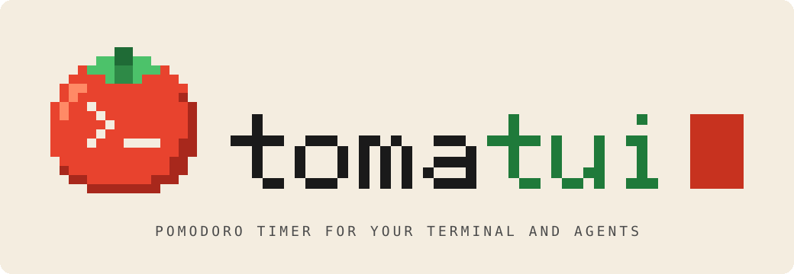

<p align="center">
  
</p>

A clean, offline-first Pomodoro TUI & agent-friendly CLI written in Rust, backed by SQLite (WAL mode).

## Features

- **Minimalist TUI**: Bold geometric half-block numerals, smooth 8× sub-cell progress bar, mouse + keyboard navigation (`1–4` or `T/P/H/S` for tabs, `,` for Settings, `Esc` to return), and 18 built-in 24-bit RGB themes.
- **Projects → Activities → Editable Sessions**: Organize work by Project and Activity, start immediately (even unassigned), and edit any live or historical session later to assign/change project, activity, status, or notes.
- **Flexible Plans**: Quick presets (`25m × 1`, `25m × 2`, `50m × 2`) or manual 3-number entry (`t` → focus mins, break mins default `5`, batches default `1`).
- **Quick-Launch CLI & Agent JSON Interface**: Launch batches directly from your shell (`tomatui backend-api --25 --2`) and let AI agents query or update sessions via structured `--json` output or direct SQLite reads.
- **Zero-Asset Audio & Alerts**: Pure in-memory synthesized PCM16 chimes + native desktop notifications.

## Installation

### Prerequisites
- **Rust & Cargo**: Install via [rustup](https://rustup.rs) (`curl --proto '=https' --tlsv1.2 -sSf https://sh.rustup.rs | sh`).
- **SQLite**: Bundled automatically inside the binary — no separate SQLite installation required.
- **OS Build Dependencies**:
  - **macOS**: None beyond Xcode Command Line Tools (`xcode-select --install`).
  - **Windows**: None beyond standard Rust toolchain.
  - **Linux**: Audio headers (`sudo apt install -y libasound2-dev pkg-config` on Debian/Ubuntu, or `sudo pacman -S alsa-lib pkgconf` on Arch).

### Option 1: Install Globally from GitHub (Recommended)

```bash
cargo install --git https://github.com/kartik0trivedi/tomatui
```

Cargo automatically downloads and compiles all Rust dependencies (including bundled SQLite) and installs the `tomatui` binary to `~/.cargo/bin/tomatui`.

### Option 2: Install from Local Clone

```bash
git clone https://github.com/kartik0trivedi/tomatui.git
cd tomatui
cargo install --path .
```

To update an existing installation after pulling changes:

```bash
cargo install --path . --force
```

### Ensure `~/.cargo/bin` is on your `PATH`

If `tomatui` is not found after installing, add Cargo's bin directory to your shell profile:

```bash
# Zsh (~/.zshrc) or Bash (~/.bashrc)
export PATH="$HOME/.cargo/bin:$PATH"
```

## Quick Start

Once installed, run `tomatui` from any terminal directory:

```bash
# Open the interactive TUI (Opening View)
tomatui

# Quick-launch 2 x 25m focus sessions on "backend-api" (5m default break)
tomatui backend-api --25 --2

# Specify an activity and custom break duration
tomatui backend-api --25 --2 --activity "API schema" --break 10

# Start an unassigned batch (assign project/activity later)
tomatui --50 --2
```

## CLI & Agent Usage

Every management and analytics subcommand supports `--json` for scripts and AI agents:

```bash
# Projects & Activities
tomatui projects list --json
tomatui projects add backend-api --json
tomatui activities add backend-api "API schema" --est 4 --json

# Sessions (inspect & edit post-hoc)
tomatui sessions list --unassigned --json
tomatui sessions edit <ID_PREFIX> --project backend-api --activity "API schema" --notes "Done" --json

# Analytics & Export
tomatui stats --range week --json
tomatui export --format csv
tomatui db-path
```

## Recommended Terminal Setup (Floating & Transparent)

For the best experience, run `tomatui` in a terminal emulator that supports **always-on-top / floating windows** and **background transparency** (such as [Ghostty](https://ghostty.org), [iTerm2](https://iterm2.com), [WezTerm](https://wezfurlong.org/wezterm/), [Kitty](https://sw.kovidgoyal.net/kitty/), or [Alacritty](https://alacritty.org)). This lets `tomatui` sit quietly in a corner of your screen as a lightweight floating Pomodoro widget while you work in other apps.

- `tomatui` inherits your terminal's transparency by default (**`, Settings` → Transparent Background: On**).
- Example Ghostty config (`~/.config/ghostty/config`):
  ```ini
  background-opacity = 0.85
  background-blur = true
  ```
  *(Use Ghostty's Window → **Float on Top** option to keep your timer visible above other windows.)*

## Data Location

By default, data is stored in a single SQLite (WAL) database:
- **macOS**: `~/Library/Application Support/com.tomatui.tomatui/tomatui.db`
- **Linux**: `~/.local/share/tomatui/tomatui.db`

You can view or relocate the database anytime from `, Settings` → **Data Location (SQLite)**, or override it via `--db <PATH>` / `TOMATUI_DB`.

## License

MIT
